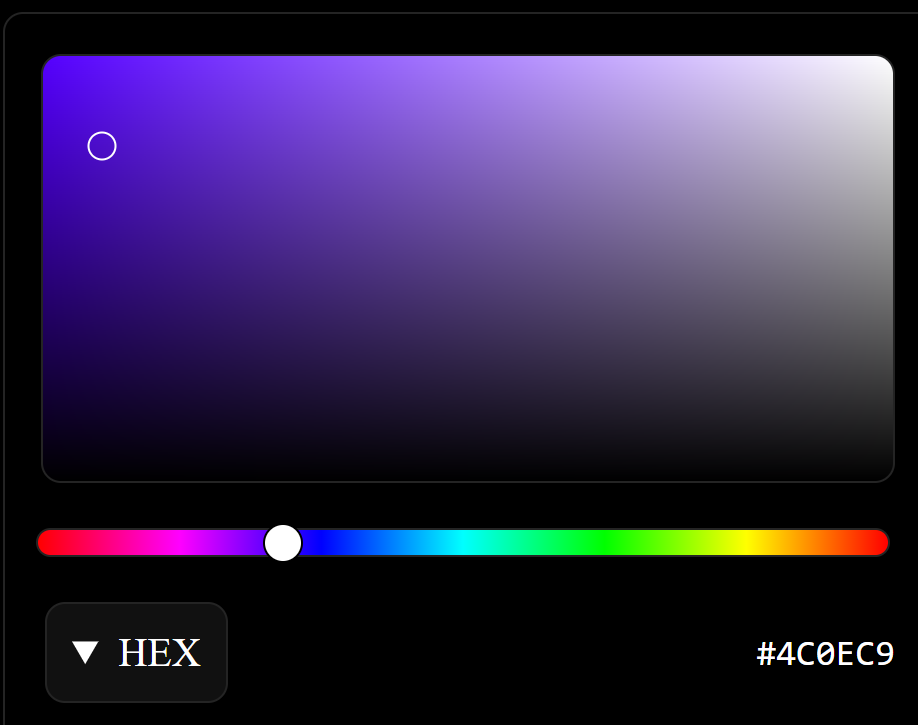

<div align="center">


# 🎬 استودیو تدوینگر ویدیوی مافوق (Mafogh Video Editor)
### ابزار اختصاصی تولید ویدیوهای ارائه‌محور، موشن‌گرافیک و محتوای شبکه‌های اجتماعی
**توسعه داده‌شده برای آژانس برندینگ مافوق ([mafogh.com](https://mafogh.com))**

[](https://react.dev)
[](https://www.typescriptlang.org)
[](https://vitejs.dev)
[](https://tailwindcss.com)
[](https://ffmpeg.org)
[](LICENSE)

---

</div>



---

## 📖 معرفی سامانه

**تدوینگر مافوق** یک وب‌اپلیکیشن تدوین و ساخت ویدیوهای ارائه‌ای با استانداردهای بالای موشن‌گرافیک است که امکان طراحی اسلایدهای متحرک با تایپوگرافی اختصاصی فارسی، انیمیشن‌های شتاب‌دار فیزیکی، زمان‌بندی دقیق صدا و نریشن، و رندر مستقیم ویدیوی باکیفیت **MP4** را از طریق موتور بومی FFmpeg فراهم می‌کند.

این سامانه با هدف تسریع تولید محتواهای ویدیویی برندینگ، آموزش‌های مارکتینگ، تحلیل‌های بیزینسی و شبکه‌های اجتماعی آژانس مافوق طراحی و پیاده‌سازی شده است.

---

## ✨ امکانات و قابلیت‌های اصلی

### 🎨 ۱. استودیوی بوم و ویرایشگر پیشرفته
- **بوم طراحی اسلایدی (Slide-based Stage):** قابلیت چینش آزاد، درگ اند دراپ و ترازبندی دقیق المان‌ها.
- **ترازبندی سریع (Quick Alignment):** ابزار هوشمند مرکزچین عمودی، افقی، راست‌چین و چپ‌چین با خطوط کمکی مغناطیسی (Snap Guides).
- **پشتیبانی کامل از زبان فارسی:** استفاده آفلاین از قلم استاندارد **وزیرمتن (Vazirmatn)** و سیستم متنی RTL بدون هیچ‌گونه به هم ریختگی حروف یا کاراکترهای ترکیبی فارسی و انگلیسی.
- **واترمارک اختصاصی مافوق:** وکتور رسمی هویت بصری آژانس مافوق (`#6b0b45`) با امکان تنظیم اندازه، شفافیت و موقعیت در ۴ گوشه یا مرکز اسلاید.

### ⚡ ۲. موشن‌گرافیک و انیمیشن‌ها
- **انیمیشن‌های فیزیکی ورود المان‌ها:**
  - `Slide Up` (حرکت نرم از پایین به بالا)
  - `Fade In` (ظهور تدریجی)
  - `Pop In` (پرش فنری و ارتجاعی)
  - `Slide Down` (حرکت نرم از بالا به پایین)
  - `Zoom In` (بزرگ‌نمایی نرم)
- **تنظیم تاخیر ورودی (Staggered Delay):** ورود مرحله‌ای عناوین، توضیحات و کارت‌ها برای درک بهتر مخاطب.
- **ترنزیشن‌های خروج اسلاید:** محو شدن تدریجی (Crossfade Out)، اسلاید به چپ و بالا.

### 🖼️ ۳. انواع المان‌های بصری
- **تیتر و عنوان اصلی (Title):** با قابلیت تنظیم وزن قلم (Bold/Black)، اندازه، ترازبندی و رنگ.
- **زیرنویس و تگ انگلیسی (Subtitle / Translation):** مناسب تیترهای دو زبانه مشابه نمونه LTV.
- **پاراگراف متن (Paragraph):** شکست خودکار خطوط و ترازبندی استاندارد.
- **المان تصویر (Image Element):** پشتیبانی از آدرس مستقیم وب یا **آپلود مستقیم فایل از کامپیوتر**، تغییر اندازه درصدی، حفظ نسبت تصویر (Aspect Ratio Lock)، دستگیره‌های کشیدن روی بوم، و دکمه ریست به ابعاد خودکار.
- **کارت‌ها و نشان‌ها (Badges & Cards):** ایجاد بلوک‌های متمایز محتوایی با پس‌زمینه و حاشیه‌های مدرن.

### ⏱️ ۴. تایم‌لاین زنده و صدا
- **تایم‌لاین تعاملی (Scrubber & Blocks):** نمایش طول هر اسلاید متناسب با مدت زمان آن، کلید میانبر **Space** برای پخش و توقف زنده با ۶۰ فریم بر ثانیه.
- **موزیک پس‌زمینه (Background Audio):** آپلود موزیک پس‌زمینه، تنظیم درصد ولوم و قابلیت Loop خودکار.

### 🚀 ۵. موتور خروجی باکیفیت و محاسبات دقیق رندر (FFmpeg Engine)
- **رندر واقعی فریم‌به‌فریم Canvas:** رندر دقیق لایه‌ها، متون، سایه‌ها و آیکون‌ها بدون افت کیفیت.
- **کیفیت‌های 1080p Full HD و 720p HD:** با نرخ فریم ۳۰ یا ۶۰ فریم بر ثانیه.
- **پایپ‌لاین بافر چندگانه (Concurrent HTTP Pipelining):** ارسال همزمان فریم‌ها به موتور بک‌اند برای حداکثر سرعت رندر.
- **محاسبه هوشمند زمان تقریبی (Accurate Live ETA):** تخمین دقیق زمان باقی‌مانده بر مبنای میانگین متحرک سرعت پردازش فریم‌ها.
- **خروجی MP4 نهایی:** همراه با صدای میکس‌شده و دانلود مستقیم فایل ویدیویی.
- **سیستم ایمپورت و اکسپورت پروژه (JSON):** ذخیره و بازیابی تمام جزئیات پروژه در قالب فایل متنی `.mafogh.json`.

---

## 🗺️ نقشه‌ی راه قابلیت‌های بعدی (Roadmap)

این قابلیت‌ها به ترتیب پیاده‌سازی و روی مخزن پوش خواهند شد:

- [ ] **قابلیت ۱:** پشتیبانی از نسبت ابعاد چندگانه (`16:9` افقی، `9:16` عمودی ریلز/استوری، `1:1` مربعی)
- [ ] **قابلیت ۲:** سیستم تاریخچه و Undo / Redo (`Ctrl+Z` و `Ctrl+Y`)
- [ ] **قابلیت ۳:** مدیریت لایه‌ها و عمق المان‌ها (Z-Index / Bring to Front / Send to Back) و قفل کردن المان
- [ ] **قابلیت ۴:** انیمیشن متنی ماشین تحریر (Typewriter Effect)
- [ ] **قابلیت ۵:** شمارنده متحرک اعداد و درصدها (Animated Counter)
- [ ] **قابلیت ۶:** کتابخانه آیکون‌های وکتور داخلی با جستجو (Icon Picker)
- [ ] **قابلیت ۷:** ضبط مستقیم صدای گوینده روی هر اسلاید (Voice Recorder) با کاهش خودکار موزیک (Audio Ducking)
- [ ] **قابلیت ۸:** پالت‌های رنگی سازمانی و کیت برند (Brand Color Kits)

---

## 💻 نحوه نصب و اجرای پروژه

### پیش‌نیازها
1. **Node.js** نسخه ۱۸ یا بالاتر
2. **FFmpeg** نصب‌شده روی سیستم و ثبت‌شده در PATH محیطی

### مراحل راه‌اندازی
```bash
# ۱. دریافت پکیج‌ها
npm install

# ۲. اجرای فرانت‌اند (پورت ۳۰۰۰)
npm run dev

# ۳. اجرای سرور بک‌اند رندرینگ FFmpeg (پورت ۳۰۰۱)
npm run server
```

> **نکته در ویندوز:** می‌توانید با دوبار کلیک روی فایل `start.bat`، کل پروژه را به صورت خودکار اجرا کنید.

سپس در مرورگر به آدرس زیر مراجعه کنید:
```
http://localhost:3000
```

---

## 🔒 حق مالکیت و مجوز (License)

تمامی حقوق این پروژه متعلق به **آژانس برندینگ مافوق** ([mafogh.com](https://mafogh.com)) و پدیدآورنده آن است.
این پروژه کاملاً **اختصاصی و محرمانه (Proprietary & Confidential)** است و هرگونه استفاده، تکثیر، کپی یا انتشار کدهای آن بدون اجازه کتبی صریح ممنوع است. جزئیات بیشتر در فایل [LICENSE](LICENSE) درج شده است.
